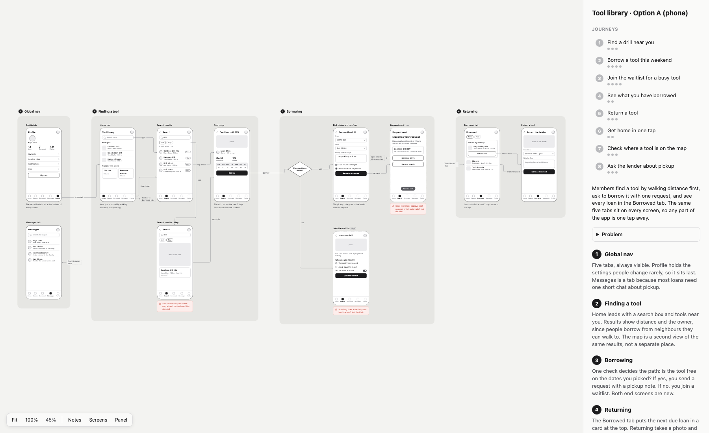
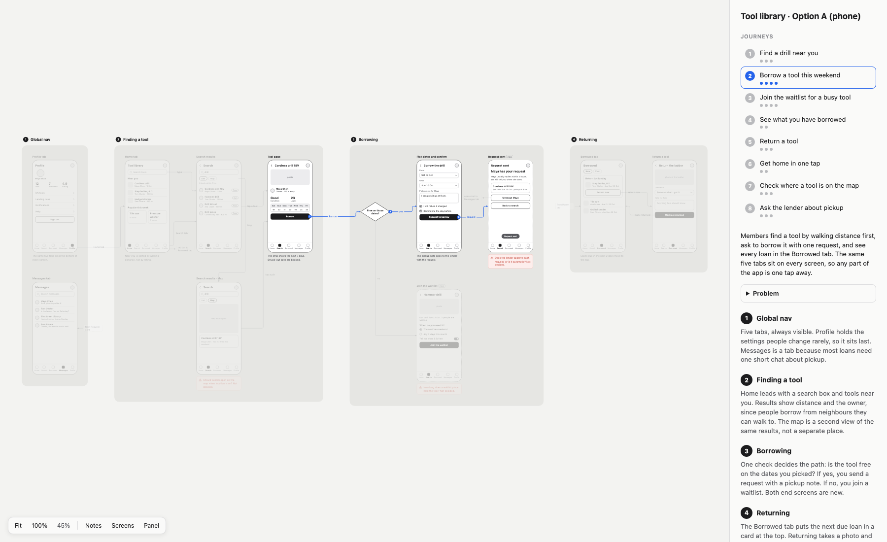
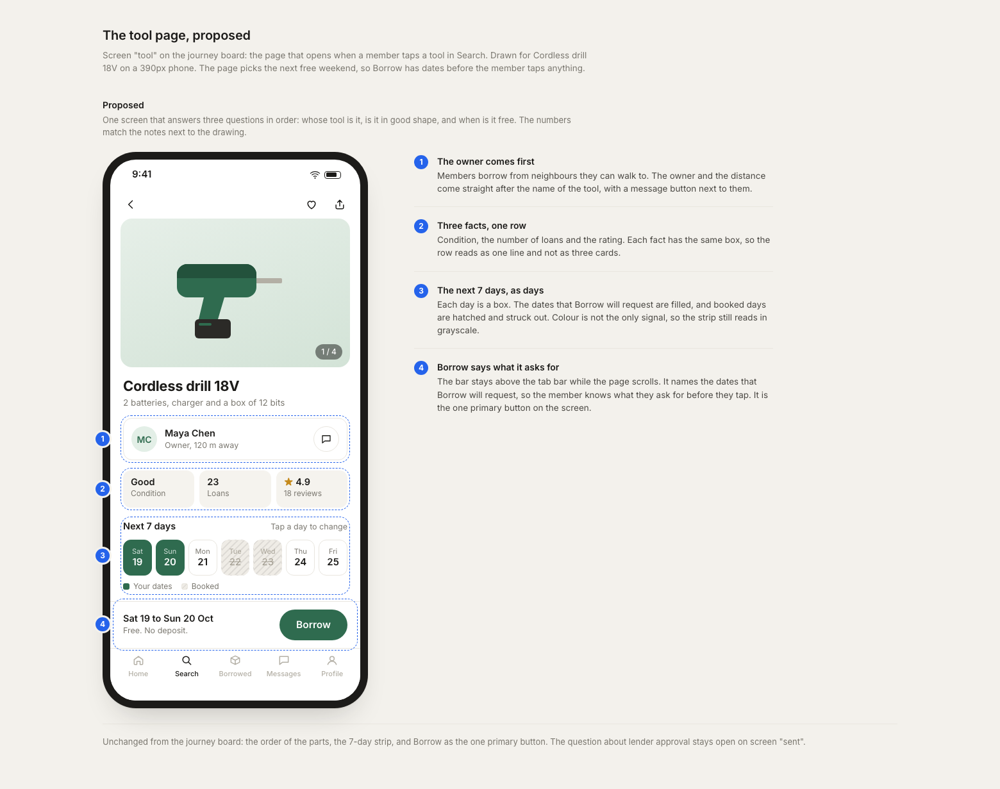

# Artboards for AI coding agents

Your coding agent draws the design as local HTML files, and you review it in the browser
on localhost. First a rough journey board to agree the flow, then real-looking screens to
agree the look.

A design is easier to agree before it is built. With this tool, the agent draws each round
in a minute, you reload a URL, and you send back notes or an annotated screenshot. It runs
on your own computer and needs no account or API key.

## Example

A lo-fi journey board for a made-up neighbourhood tool library. Screens sit in numbered
regions, labelled arrows join them, and the side panel lists the user journeys:



When you move the pointer over a journey, the board shows that path with numbered steps
and fades the rest:



After the flow is agreed, the agent draws the screens where the look matters as hi-fi
artboards, with numbered notes:



The files are in [examples/tool-library](examples/tool-library).

## Install

You need macOS or Linux, and [uv](https://docs.astral.sh/uv/). uv installs Python 3.11 or
later if you do not have it.

```bash
git clone https://github.com/pranav7/artboards.git ~/artboards
ln -s ~/artboards/bin/artboards ~/.local/bin/artboards   # or any directory on PATH
artboards doctor
```

`artboards doctor` installs the Python packages and a headless Chromium, then checks the
example board. It is safe to run again.

## Use

For Claude Code, link the skill:

```bash
ln -s ~/artboards/skills/artboard ~/.claude/skills/artboard
```

For Codex, link the same folder to `~/.codex/skills/artboard`. For another agent, give it
`skills/artboard/SKILL.md`.

Then ask: "Draw the journeys for the new checkout flow, so we can agree them."

The agent runs `artboards serve` when the server is not up, and gives you a URL such as
`http://localhost:8899/<group>/1-Checkout.html`. Open `http://localhost:8899/` for the review
queue: each group with work to review, and the state of each artboard. The server closes a
group when its pull request merges, when all of its artboards are agreed, or after 7 days
with no change. To close a group yourself, click **Archive** on it. Closed groups are on
`http://localhost:8899/history`, where **Reopen** puts a group back in the queue.

## Keep the server on

On macOS, a launchd agent starts the server when you log in and starts it again if it
stops. Save this file as `~/Library/LaunchAgents/dev.artboards.serve.plist`. Change
`/Users/you` to your home folder:

```xml
<?xml version="1.0" encoding="UTF-8"?>
<!DOCTYPE plist PUBLIC "-//Apple//DTD PLIST 1.0//EN" "http://www.apple.com/DTDs/PropertyList-1.0.dtd">
<plist version="1.0">
<dict>
  <key>Label</key><string>dev.artboards.serve</string>
  <key>ProgramArguments</key>
  <array>
    <string>/Users/you/artboards/bin/artboards</string>
    <string>serve</string>
  </array>
  <key>EnvironmentVariables</key>
  <dict>
    <key>PATH</key><string>/Users/you/.local/bin:/opt/homebrew/bin:/usr/local/bin:/usr/bin:/bin</string>
  </dict>
  <key>RunAtLoad</key><true/>
  <key>KeepAlive</key><true/>
  <key>StandardOutPath</key><string>/Users/you/.local/share/artboards/.server.log</string>
  <key>StandardErrorPath</key><string>/Users/you/.local/share/artboards/.server.log</string>
</dict>
</plist>
```

Load it:

```bash
mkdir -p ~/.local/share/artboards
launchctl bootstrap gui/$(id -u) ~/Library/LaunchAgents/dev.artboards.serve.plist
```

The `PATH` entry lets launchd find `uv`. On Linux, use a systemd user service that runs
`artboards serve`.

## License

MIT. For the licenses of the dependencies, and for how to change the tool, see
[CONTRIBUTING.md](CONTRIBUTING.md).
